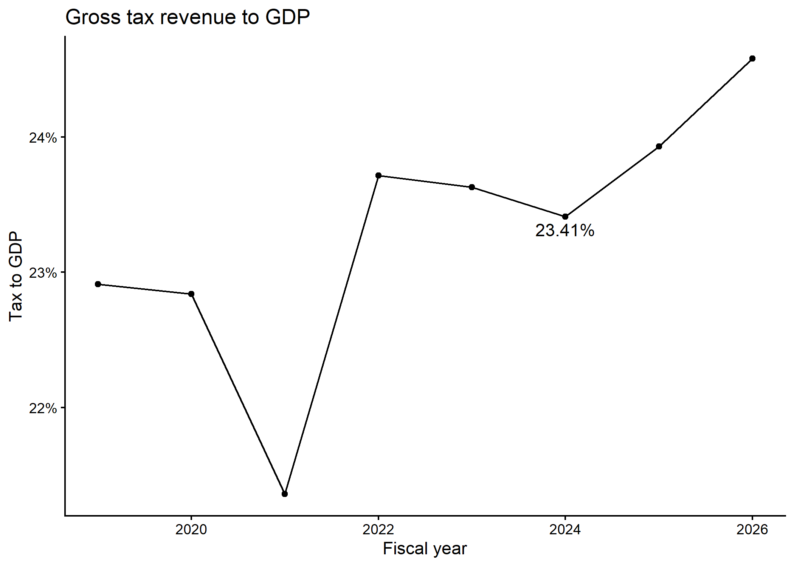
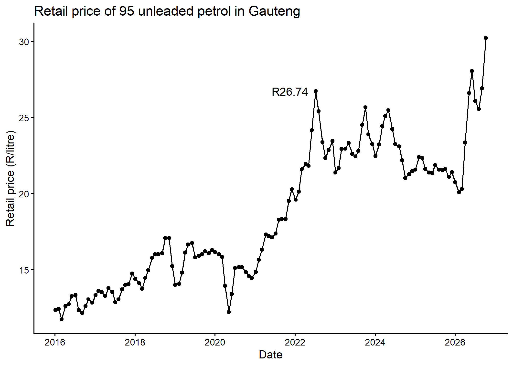
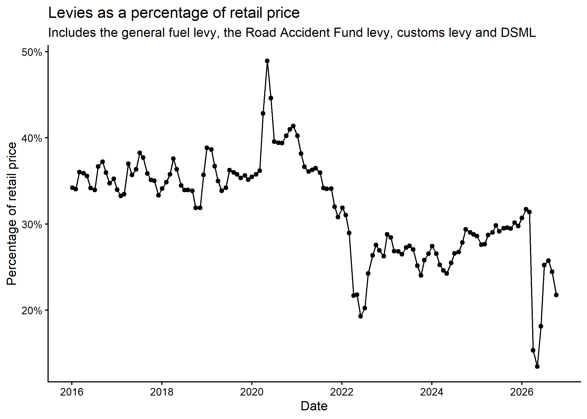

<!-- README.md is generated from README.Rmd. Please edit that file -->

# tax4sa

<!-- badges: start -->

<!-- badges: end -->

This is a minimal package to help with the compilation and analysis of
tax and economic data in South Africa. The package contains numerous
sets of data, three functions and the personal income tax tables.

The data includes:

- **Monthly tax revenue collections** as published in the [monthly
  financing statements of the National
  Treasury](http://www.treasury.gov.za/comm_media/press/monthly/default.aspx)
  - `NT_S32_revenue`: From April 2002 to August 2026 with 11,147 rows
- **Annual tax revenue collections** as published in the [Budget Reviews
  of the National
  Treasury](http://www.treasury.gov.za/documents/national%20budget/default.aspx)
  - `NT_Budget_revenue`: From 1983/84 to 2025/26 with 1,591 rows
- **Personal income tax tables** from the [Budget Reviews of the
  National
  Treasury](http://www.treasury.gov.za/documents/national%20budget/default.aspx)
  - `NT_Budget_PIT_brackets`: From 1995/96 to 2026
  - `NT_Budget_PIT_rebates`
- **Forecasts of the main tax instruments and GDP** as published in the
  [Budget Reviews of the National
  Treasury](http://www.treasury.gov.za/documents/national%20budget/default.aspx)
  - `NT_Budget_forecasts`: From 2005 to the 2026 Budget with 1,308 rows
- **Monthly trade data on imports and exports** from the [South African
  Revenue
  Service](https://tools.sars.gov.za/tradestatsportal/data_download.aspx)
  - `tbl(dbConnect(duckdb()), "SARS_*.parquet")`: Need to download
    locally using code below. From January 2010 to August 2026 with
    47,330,150 rows
- **Quarterly Bulletin data** from the [South African Reserve
  Bank](https://www.resbank.co.za/en/home/publications/quarterly-bulletin1/download-information-from-xlsx-data-files)
  - `SARB_Quarterly_Bulletin`: Up to the September 2026 Quarterly
    Bulletin with 734,390 rows
  - `SARB_Quarterly_Bulletin_info`: Detailed descriptions of variables
- **Petrol and diesel prices and levies** from the [Department of
  Mineral Resources and
  Energy](http://www.energy.gov.za/files/esources/petroleum/petroleum_arch.html)
  - `DMRE_fuel`: From January 2012 to October 2026
- **Monthly releases of economic statistics** from [Statistics South
  Africa](http://www.statssa.gov.za/?page_id=1847)
  - `STATSSA_P0043_insolvencies`: Up to September 2026 with 450 rows
  - `STATSSA_P0043.1_liquidations`: Up to August 2026 with 15,040 rows
  - `STATSSA_P0141_CPI_COICOP`: Up to September 2026 with 177,525 rows
  - `STATSSA_P0141_CPI_province`: Up to September 2026 with 287,235 rows
  - `STATSSA_P0141_CPI_digits`: Up to September 2026 with 87,975 rows
  - `STATSSA_P0141_CPI_urban`: Up to September 2026 with 45,747 rows
  - `STATSSA_P0142.1_PPI`: Up to August 2026 with 13,376 rows
  - `STATSSA_P0142.7_trade`: Up to August 2026 with 8,704 rows
  - `STATSSA_P0151.1_construction`: Up to August 2026 with 24,400 rows
  - `STATSSA_P0441_GDP`: Up to Q2 2025 with 20,016 rows
  - `STATSSA_P0441_GDP_base_2015`: Up to Q2 2025 with 79,435 rows
  - `STATSSA_P2041_mining`: Up to December 2002 with 11,316 rows
  - `STATSSA_P3041.2_manufacturing`: Up to August 2026 with 11,316 rows
  - `STATSSA_P4141_electricity`: Up to August 2026 with 9,280 rows
  - `STATSSA_P5041.1_building`: Up to August 2026 with 180,480 rows
  - `STATSSA_P6141.2_wholesale`: Up to August 2026 with 5,120 rows
  - `STATSSA_P6242.1_retail`: Up to August 2026 with 5,120 rows
  - `STATSSA_P6343.2_vehicles`: Up to July 2026 with 8,932 rows
  - `STATSSA_P6410_tourists`: Up to August 2026 with 17,775 rows
  - `STATSSA_P6420_food`: Up to July 2026 with 16,128 rows
  - `STATSSA_P7162_transport`: Up to July 2026 with 8,697 rows

The three functions and the personal income tax tables are intended to
help with calculating tax liabilities, particularly when used with the
[administrative data from
SARS](https://sa-tied.wider.unu.edu/sites/default/files/pdf/SATIED_WP36_Ebrahim_Axelson_March_2019.pdf).

## Installation

You can install the package from [GitHub](https://github.com/) with:

``` r
# install.packages("remotes")
remotes::install_github("chrisaxelson/tax4sa")
```

## Data

The data can be accessed by entering either `NT_Budget_revenue`,
`NT_S32_revenue`, `SARB_Quarterly_Bulletin`,
`STATSSA_P0441_GDP`,`DMRE_fuel`, etc. and is in a tidy format to ease
analysis within R. The package needs to be reinstalled to update the
data. If you would like to load all the data into your environment to
check what is available, you can run:

``` r
library(tax4sa)
load_tax4sa_data()
```

### National Treasury

#### Revenue

The tax revenue data is split by three revenue classifications in
columns `T1`, `T2` and `T3` and all figures are in ZAR 000’s.

``` r
library(dplyr)
library(knitr)
library(kableExtra)

# Check revenue data
NT_Budget_revenue %>% 
  filter(Fiscal_year == 2026) %>%  
  select(T1:T3, Year, Revenue) %>% 
  mutate(Revenue = round(Revenue,0)) %>% 
  head(5) %>% 
  kable(format.args = list(big.mark = ","), 
        caption = "Annual tax revenue (R'000s)")
```

| T1 | T2 | T3 | Year | Revenue |
|:---|:---|:---|:---|---:|
| Taxes on income and profits | Personal income tax | Personal income tax | 2025/26 | 790,619,211 |
| Taxes on income and profits | Tax on corporate income | Corporate income tax | 2025/26 | 345,432,054 |
| Taxes on income and profits | Tax on corporate income | Secondary tax on companies/dividend withholding tax | 2025/26 | 7,983 |
| Taxes on income and profits | Tax on corporate income | Withholding tax on dividends | 2025/26 | 45,876,462 |
| Taxes on income and profits | Tax on corporate income | Interest withholding tax | 2025/26 | 1,063,927 |

Annual tax revenue (R’000s)

``` r

# And monthly
NT_S32_revenue %>% 
  filter(T3 == "Health promotion levy") %>% 
  select(Tax = T3, Month, Quarter, Year, Fiscal_year, Revenue) %>% 
  mutate(Year = as.character(Year),
         Fiscal_year = as.character(Fiscal_year)) %>% 
  tail(5) %>% 
  kable(format.args = list(big.mark = ","),
        caption = "Monthly health promotion levy revenue (R'000s)") 
```

| Tax                   | Month  | Quarter | Year | Fiscal_year |   Revenue |
|:----------------------|:-------|--------:|:-----|:------------|----------:|
| Health promotion levy | April  |       2 | 2026 | 2027        | 244,223.8 |
| Health promotion levy | May    |       2 | 2026 | 2027        | 175,945.4 |
| Health promotion levy | June   |       2 | 2026 | 2027        | 142,776.1 |
| Health promotion levy | July   |       3 | 2026 | 2027        | 144,374.0 |
| Health promotion levy | August |       3 | 2026 | 2027        | 179,242.3 |

Monthly health promotion levy revenue (R’000s)

Or you can download the annual and monthly data in one spreadsheet.

``` r
# This saves it in your current working directory
# download.file("https://raw.githubusercontent.com/chrisaxelson/tax4sa/master/data-raw/NT/Revenue.xlsx",
#               "Revenue.xlsx")
```

Similarly, you can access the forecasts that were made in the annual
Budget Reviews below.

``` r
# Check revenue data
NT_Budget_forecasts %>% 
  filter(Publication_year == 2026,
         Category == "Gross tax revenue") %>% 
   mutate(Publication_year = as.character(Publication_year)) %>% 
  kable(format.args = list(big.mark = ","), 
        caption = "Tax revenue forecasts (R million)")
```

| Source | Publication_year | Category          | Forecast_year |  Forecast |
|:-------|:-----------------|:------------------|:--------------|----------:|
| Budget | 2026             | Gross tax revenue | 2025/26       | 2,006,947 |
| Budget | 2026             | Gross tax revenue | 2026/27       | 2,126,962 |
| Budget | 2026             | Gross tax revenue | 2027/28       | 2,248,628 |
| Budget | 2026             | Gross tax revenue | 2028/29       | 2,376,153 |

Tax revenue forecasts (R million)

Or you can download the forecasts in one spreadsheet.

``` r
# This saves it in your current working directory
# download.file("https://raw.githubusercontent.com/chrisaxelson/tax4sa/master/data-raw/NT/Forecasts.xlsx",
#               "Forecasts.xlsx")
```

### South African Revenue Service

#### Trade data

The line-by-line trade data from the South African Revenue Service is
too large to be included directly in the package, but can be downloaded
separately per year of data and type of trade (imports or exports). Each
file is around 20MB.

The following code downloads the data into your working directory using
the
[piggyback](https://cran.r-project.org/web/packages/piggyback/vignettes/intro.html)
package. The data is likely to be too large to be loaded into R on most
computers, so it is saved as individual
[parquet](https://www.upsolver.com/blog/apache-parquet-why-use) files
where you can use [duckdb](https://duckdb.org/) to query all the data
without moving it into RAM. Any subsequent runs of the code will only
download updated data files.

``` r
library(piggyback)

# # Download individual files - can adjust imports to exports and the year
pb_download("SARS_imports_2022.parquet",
            repo = "chrisaxelson/tax4sa")

# # Or download ALL the trade data from Github - about 600MB
# # If run again, will only download updated data
pb_download(repo = "chrisaxelson/tax4sa")

# Quick example of how to access the data
library(duckdb)

# Create connection to temporary database in memory
con <- dbConnect(duckdb())

# Reference from all the parquet files in that folder
tbl(con, "SARS_*.parquet") %>% 
  head(5) %>% 
  mutate(YearMonth = as.character(YearMonth)) %>% 
  select(TradeType, District = DistrictOfficeName, Origin = CountryOfOriginName, Destination  = CountryOfDestinationName, Unit = StatisticalUnit,
         YearMonth, ChapterAndDescription, Quantity = StatisticalQuantity, Value_ZAR = CustomsValue) %>% 
  kable(format.args = list(big.mark = ","),
        caption = "Monthly trade data")
```

| TradeType | District | Origin | Destination | Unit | YearMonth | ChapterAndDescription | Quantity | Value_ZAR |
|:---|:---|:---|:---|:---|:---|:---|---:|---:|
| Exports | Alexanderbay | China | Namibia | KG | 201001 | 61 - Clothing and accessories, knitted or crocheted | 57 | 930 |
| Exports | Alexanderbay | China | Namibia | NO | 201001 | 61 - Clothing and accessories, knitted or crocheted | 7 | 634 |
| Exports | Alexanderbay | Bangladesh | Namibia | NO | 201001 | 61 - Clothing and accessories, knitted or crocheted | 8 | 288 |
| Exports | Alexanderbay | China | Namibia | NO | 201001 | 62 - Clothing and accessories, not knitted or crocheted | 51 | 7,979 |
| Exports | Alexanderbay | China | Namibia | NO | 201001 | 62 - Clothing and accessories, not knitted or crocheted | 96 | 7,930 |

Monthly trade data

## South African Reserve Bank

``` r
# Look for SARB economic data on GDP
SARB_Quarterly_Bulletin_info %>% 
  filter(grepl("Gross domestic product at market prices", Description), Frequency == "K1") %>%
  select(-Description, -Frequency) %>% 
  kable()
```

| Code | Frequency_description | Unit_of_measure | Version_description |
|:---|:---|:---|:---|
| KBP6006C | Quarterly | RMILL | Constant 2010 prices |
| KBP6006D | Quarterly | RMILL | Constant 2010 prices. Seasonally adjusted at annual rate |
| KBP6006K | Quarterly | RMILL | Current prices |
| KBP6006L | Quarterly | RMILL | Current prices. Seasonally adjusted at annual rate |
| KBP6006S | Quarterly | PERC | 1-Term % change |

``` r

SARB_Quarterly_Bulletin %>% 
  filter(Code == "KBP6006K") %>% 
  select(-Month) %>% 
  tail(5) %>% 
  kable()
```

| Code     |     Date | Frequency | Quarter | Year | Fiscal_year |   Value |
|:---------|---------:|:----------|--------:|-----:|------------:|--------:|
| KBP6006K | 20250200 | K1        |       2 | 2025 |        2026 | 1900275 |
| KBP6006K | 20250300 | K1        |       3 | 2025 |        2026 | 1938471 |
| KBP6006K | 20250400 | K1        |       4 | 2025 |        2026 | 2003972 |
| KBP6006K | 20260100 | K1        |       1 | 2026 |        2026 | 1944611 |
| KBP6006K | 20260200 | K1        |       2 | 2026 |        2027 | 1986162 |

## Statistics South Africa

``` r
# Look for STATSSA inflation data
STATSSA_P0141_CPI_COICOP %>% 
  filter(H04 == "CPI Headline") %>%
  select(H01, H04, Date_original, Value) %>% 
  mutate(Annual_inflation = as.numeric(Value) / as.numeric(lag(Value, 12)) - 1,
         Annual_inflation = round(Annual_inflation * 100, 3)) %>% 
  tail(5) %>% 
  kable()
```

| H01   | H04          | Date_original | Value | Annual_inflation |
|:------|:-------------|:--------------|:------|-----------------:|
| P0141 | CPI Headline | MO052026      | 106.7 |            4.505 |
| P0141 | CPI Headline | MO062026      | 107.5 |            4.980 |
| P0141 | CPI Headline | MO072026      | 107.7 |            4.259 |
| P0141 | CPI Headline | MO082026      | 107.7 |            4.360 |
| P0141 | CPI Headline | MO092026      | 108.1 |            4.545 |

## Department of Mineral Resources and Energy

Note that the `Price` column reflects retail prices for unleaded petrol,
wholesale list prices for diesel and illuminating paraffin and maximum
retail price for liquified petroleum gas.

``` r
# Look for STATSSA inflation data
DMRE_fuel %>% 
  select(Fuel_type:General_fuel_levy) %>% 
  tail(10) %>% 
  kable()
```

| Fuel_type | Region | Date | Price | Basic_fuel_price | General_fuel_levy |
|:---|:---|:---|---:|---:|---:|
| 95_ULP | Coastal | 2026-10-07 | 2938.00 | 1743.51 | 429 |
| 95_ULP | Gauteng | 2026-10-07 | 3025.00 | 1743.51 | 429 |
| Diesel_0.005 | Coastal | 2026-10-07 | 3192.69 | 2298.03 | 416 |
| Diesel_0.005 | Gauteng | 2026-10-07 | 3279.89 | 2298.03 | 416 |
| Diesel_0.05 | Coastal | 2026-10-07 | 3108.29 | 2213.63 | 416 |
| Diesel_0.05 | Gauteng | 2026-10-07 | 3195.49 | 2213.63 | 416 |
| Illuminating_Paraffin | Coastal | 2026-10-07 | 2341.70 | NA | NA |
| Illuminating_Paraffin | Gauteng | 2026-10-07 | 2447.10 | NA | NA |
| Liquefied_Petroleum_Gas | Coastal | 2026-10-07 | 3456.00 | NA | NA |
| Liquefied_Petroleum_Gas | Gauteng | 2026-10-07 | 3781.00 | NA | NA |

## Functions

The three functions are `tax_calculation`, `pit` and `pit_manual`. The
first is a generic function to apply a tax table to a value, while the
latter two specifically calculate the personal income tax liability in
South Africa. `pit_manual` allows for a custom tax table to be applied
to cater for modelling the impacts of changes in the personal income tax
tables. The package includes a list of historical tax tables to be used
in the calculations.

``` r
# Accessing tax tables
tax_calculation(100000, Tax_tables$PIT_brackets_2024)
#> [1] 18000

# Calculate personal income tax
pit(income = 1000000, age = 53, mtc = 2550, tax_year = 2024)
#> [1] 289734

# Same calculation in a relatively large dataframe with differing variables
individuals <- 1e6
df <- data.frame(Taxable_income = round(runif(individuals, 0, 3000000),0),
                 Age = round(runif(individuals, 18, 80),0),
                 MTC = round(runif(individuals, 0, 6000), 0),
                 Tax_year = round(runif(individuals, 2014, 2020), 0))

system.time({
  df <- df %>% 
    mutate(Simulated_tax = pit(Taxable_income, Age, MTC, Tax_year))
})
#>    user  system elapsed 
#>    0.38    0.03    0.39
```

## Examples

``` r
library(tax4sa)
library(dplyr)
library(ggplot2)
library(scales)

# Create a tax to GDP chart - revenue per year first
Total_revenue <- NT_Budget_revenue %>% 
  group_by(Fiscal_year) %>% 
  summarise(Revenue = sum(Revenue))

# Get nominal GDP across fiscal year by summing per quarter
GDP_fiscal <- STATSSA_P0441_GDP %>% 
  filter(H03 == "QNU1000") %>% 
  group_by(Fiscal_year) %>% 
  summarise(GDP = sum(Value)) %>% 
  filter(Fiscal_year < 2027, Fiscal_year > 2018)

# Join together and create tax to GDP
Tax_to_GDP <- GDP_fiscal %>% 
  inner_join(Total_revenue, by = "Fiscal_year") %>% 
  mutate(Revenue = Revenue / 1000,
         Tax_to_GDP = Revenue / GDP)

# Chart
ggplot(Tax_to_GDP, aes(x = Fiscal_year, y = Tax_to_GDP)) +
  geom_line() + 
  geom_point() +
  geom_text(aes(label = ifelse(Fiscal_year == 2024,
                               paste0(round(Tax_to_GDP,4) * 100, "%"),'')),
            hjust=0.5, vjust=1.5, show.legend = FALSE) +
  scale_y_continuous(labels = scales::percent_format(accuracy = 1L)) +
  theme_classic() +
  ylab("Tax to GDP") +
  xlab("Fiscal year") +
  ggtitle("Gross tax revenue to GDP")
```



``` r
library(lubridate)

DMRE_fuel %>% 
  filter(Fuel_type == "95_ULP",
         Region == "Gauteng",
         Date > dmy("01012016")) %>% 
  ggplot(aes(x = Date, y = Price/100)) + 
  geom_line() +
  geom_point() +
  theme_classic() +
  ylab("Retail price (R/litre)") +
  ggtitle("Retail price of 95 unleaded petrol in Gauteng") +
  geom_text(aes(label = ifelse(Date == "2022-07-06", 
                               paste0("R", Price/100),'')),
            hjust=1.2, vjust=0.5, show.legend = FALSE)
```



``` r

DMRE_fuel %>% 
  filter(Fuel_type == "95_ULP",
         Region == "Gauteng",
         Date > dmy("01012016")) %>% 
  mutate(Tax = General_fuel_levy + 
           Road_accident_fund_levy + 
           Customs_and_excise_levy + 
           Demand_side_management_levy,
         Tax_percentage = Tax / Price) %>% 
  ggplot(aes(x = Date, y = Tax_percentage)) + 
  geom_line() +
  geom_point() +
  theme_classic() +
  scale_y_continuous(labels = scales::percent_format(accuracy = 1L)) +
  ylab("Percentage of retail price") +
  ggtitle("Levies as a percentage of retail price",
          subtitle = c("Includes the general fuel levy, the Road Accident Fund levy, customs levy and DSML")) 
```



<!-- ```{r cpi, message = FALSE} -->

<!-- # Get headline CPI index and check growth -->

<!-- CPI <- STATSSA %>%  -->

<!--   filter(Code == "CPS00000") %>%  -->

<!--   mutate(Value = as.numeric(Value),  -->

<!--          Change = Value / lag(Value, n = 12) - 1) -->

<!-- # Chart -->

<!-- ggplot(CPI, aes(x = Fiscal_year, y = Tax_to_GDP)) + -->

<!--   geom_line(color = "darkblue") +  -->

<!--   geom_point(color = "darkblue") + -->

<!--   scale_y_continuous(labels = scales::percent_format(accuracy = 1L)) + -->

<!--   theme_minimal() + -->

<!--   theme(axis.title.x = element_blank()) + -->

<!--   ylab("Tax to GDP") + -->

<!--   ggtitle("Total tax revenue to GDP") -->

<!-- ``` -->
